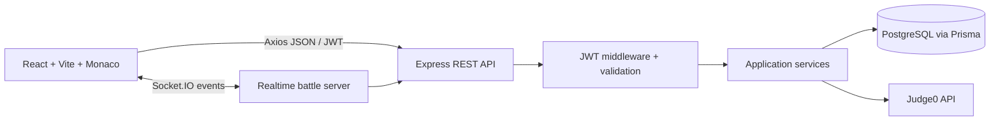

# CodeArena

CodeArena is a full-stack competitive coding and interview-practice platform. Its differentiator is a timed 1v1 battle loop that can match a live player or same-level bot, preserve the result, and feed performance signals back into the learner dashboard.

## Tech Stack

- Frontend: React, Vite, Tailwind CSS, React Router, Axios, Monaco Editor
- Backend: Node.js, Express, Socket.IO, JWT, Prisma
- Database: PostgreSQL
- Code execution: Judge0 API
- Optional scale services: Redis for distributed Socket.IO presence and a future AI review service

## Implemented product capabilities

The repository is organized as a full-stack workspace with a safe local demo mode and production-ready integration points:

```text
codearena/
  frontend/   React + Vite + Tailwind client
  backend/    Express + Prisma API server
  docs/       Product and engineering planning
```

- JWT signup/login and protected routes
- Monaco practice editor with language-aware starter code
- Problem, debugging, MCQ, interview, leaderboard, and analytics experiences
- Judge0 adapter with asynchronous polling, verdict mapping, timeout, and execution-error handling
- Matchmaking by level with bot fallback, private room invites, timer, Socket.IO reconnect state, battle-room events, rating updates, and persisted demo history
- Learner intelligence: skill profile, topic weakness map, explainable next action, and interview readiness report
- Battle Debrief: a transparent post-match learning loop that turns wins/losses into a reason and a next practice action
- PostgreSQL/Prisma schema and persistence paths for users, submissions, MCQ attempts, battles, and leaderboard data

## Quick Start

Install dependencies:

```bash
npm install
```

Create environment files:

```bash
cp backend/.env.example backend/.env
cp frontend/.env.example frontend/.env
```

Run both services together:

```bash
npm run dev
```

Open `http://127.0.0.1:5173/login`.

Run the frontend only:

```bash
npm run dev:frontend
```

Run the backend:

```bash
npm run dev:backend
```

In demo mode, newly created accounts are stored in `backend/src/data/users.json` so they remain available after a development server restart. For production, set `DEMO_MODE=false` and use the configured PostgreSQL database.

Battle outcomes are also persisted to `backend/src/data/battles.json` in demo mode. This keeps the demo useful without pretending that local JSON is a production database.

## Current Routes

Frontend:

- `/signup`
- `/login`
- `/dashboard`

Backend:

- Backend runs on `http://127.0.0.1:5050` by default
- `GET /health`
- `GET /api/v1`
- `POST /api/v1/auth/signup`
- `POST /api/v1/auth/login`
- `GET /api/v1/auth/me`
- `GET /api/v1/dashboard/me`
- `GET /api/v1/problems`
- `POST /api/v1/submissions/run`
- `POST /api/v1/submissions/submit`
- `GET /api/v1/debugging`
- `GET /api/v1/mcq`
- `GET /api/v1/battles`
- `GET /api/v1/platform/leaderboard`
- `GET /api/v1/platform/interview`
- `GET /api/v1/platform/analytics`
- `GET /api/v1/battles/history`
- `POST /api/v1/battles/:battleId/finish`

See [docs/API.md](docs/API.md) for request and response contracts and [docs/DEMO_CHECKLIST.md](docs/DEMO_CHECKLIST.md) for a repeatable product demonstration.

## Architecture



For local development, the same API uses catalog JSON and `DEMO_MODE=true` when PostgreSQL or Judge0 credentials are not available. That fallback is explicit and isolated; it does not change the production architecture.

## Production readiness checklist

1. Set `DEMO_MODE=false`, configure `DATABASE_URL`, generate Prisma client, and run the migration
2. Add `JUDGE0_API_URL` and `JUDGE0_API_KEY`; without them the local problem-aware judge remains active intentionally
3. Deploy the frontend and backend, then set `CLIENT_URL` and `VITE_API_URL`
4. Use Redis adapter when running more than one Socket.IO instance
5. Capture screenshots and a short battle demo using the checklist

The first target is: user can log in, open a coding problem, write code, run it, and see output.
