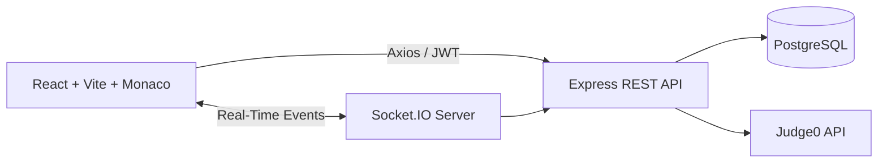

# 🚀 CodeArena – Real-Time Coding Platform

CodeArena is a full-stack competitive coding and interview-practice platform. Its main feature is a timed 1v1 coding battle system that matches users with live players or bots of similar skill levels. It helps developers improve their programming skills through coding challenges, practice sessions, and competitive battles.

## 🛠️ Tech Stack

### Frontend
- React.js
- Vite
- Tailwind CSS
- React Router
- Axios
- Monaco Editor

### Backend
- Node.js
- Express.js
- Socket.IO
- JWT Authentication
- Prisma ORM

### Database
- PostgreSQL

### Code Execution
- Judge0 API

### Other Technologies
- Git and GitHub
- Redis (optional for scaling)

## ✨ Features

- User Registration and Login
- JWT Authentication and Protected Routes
- Interactive User Dashboard
- Browse and Solve Coding Problems
- Monaco Code Editor
- Online Code Execution
- Submit Coding Solutions
- Debugging Practice
- MCQ Practice
- Mock Interview Practice
- Real-Time 1v1 Coding Battles
- Matchmaking Based on Skill Level
- Bot Opponent Support
- Private Battle Rooms
- Live Battle Timer and Updates
- Leaderboard and Rating System
- Progress Tracking and Analytics
- Battle Results and Performance Reports


## 📂 Project Structure


```text
CodeArena/
├── frontend/
├── backend/
├── docs/
│   └── screenshots/
│       ├── login.png
│       ├── dashboard.png
│       ├── editor.png
│       ├── battle.png
│       └── leaderboard.png
├── scripts/
├── package.json
├── package-lock.json
└── README.md
```

## ⚙️ Installation and Setup

### 1. Clone the Repository

```bash
git clone https://github.com/priyanshuuxx/codearena-realtime-coding-platform.git
```

### 2. Open the Project

```bash
cd codearena-realtime-coding-platform
```

### 3. Install Dependencies

```bash
npm install
```

### 4. Configure Environment Variables

Create environment files:

```bash
cp backend/.env.example backend/.env
cp frontend/.env.example frontend/.env
```

Configure the required database URL, API keys, and other environment variables according to your setup.

Never upload secret keys, passwords, or tokens to GitHub.

### 5. Run the Application

```bash
npm run dev
```

Open the frontend URL displayed in your terminal.

## 🚀 Deploy to Vercel and Render

This repository includes a Render Blueprint for the API and PostgreSQL database (`render.yaml`) and Vercel build settings (`vercel.json`) for the frontend.

1. Push the project to GitHub, then import the repository into Vercel. Keep the project root at the repository root; the included config builds the `frontend` workspace and publishes `frontend/dist`.
2. In Vercel Project Settings → Environment Variables, set `VITE_API_URL` to `https://<your-render-service>.onrender.com/api/v1` and `VITE_SOCKET_URL` to `https://<your-render-service>.onrender.com`. Set them for Production and Preview as needed, then redeploy.
3. In Render, create a Blueprint from the same repository using `render.yaml`. It provisions a free API service and PostgreSQL database, generates `JWT_SECRET`, applies Prisma migrations during the build, and seeds the problem and quiz catalogs.
4. After Render creates the service, set `CLIENT_URL` in the Render API service to the Vercel production origin (for example `https://codearena.vercel.app`, with no trailing slash). Set `CLIENT_URLS` to a comma-separated list if more than one Vercel origin needs API access. Save and redeploy the Render service.
5. Visit `https://<your-render-service>.onrender.com/health`; it should return JSON with `status: "ok"`. Then test signup/login, problems, quiz attempts, submissions, and a Socket.IO connection from the Vercel site.

Render's free web service sleeps after inactivity, so its first request can take a while. The free PostgreSQL database expires after 30 days; download a backup or upgrade it before then to keep user data. The battle presence and private-room state are process-local, so keep the API at one instance; they are not designed for multi-instance scaling yet. Add `JUDGE0_API_KEY` in Render if you want remote code execution rather than the app's local fallback.

## 🌐 Application Routes

### Frontend
- `/signup`
- `/login`
- `/dashboard`

### Backend API
- `GET /health`
- `GET /api/v1`
- `POST /api/v1/auth/signup`
- `POST /api/v1/auth/login`
- `GET /api/v1/auth/me`
- `GET /api/v1/dashboard/me`
- `GET /api/v1/problems`
- `POST /api/v1/submissions/run`
- `POST /api/v1/submissions/submit`
- `GET /api/v1/debugging`
- `GET /api/v1/mcq`
- `GET /api/v1/battles`
- `GET /api/v1/platform/leaderboard`
- `GET /api/v1/platform/interview`
- `GET /api/v1/platform/analytics`

See `docs/API.md` for API documentation and `docs/DEMO_CHECKLIST.md` for the demonstration checklist.

## 🏗️ Architecture



## 🚀 Future Improvements

- Production deployment
- Redis-based distributed matchmaking
- Advanced AI-powered code reviews
- More coding problems and interview challenges
- Enhanced performance analytics

## 👨‍💻 Developer

**Project Name:** CodeArena – Real-Time Coding Platform

**GitHub:** [priyanshuuxx](https://github.com/priyanshuuxx)

**Repository:** [CodeArena GitHub Repository](https://github.com/priyanshuuxx/codearena-realtime-coding-platform)

## 📄 License

This project is developed for educational and learning purposes.
