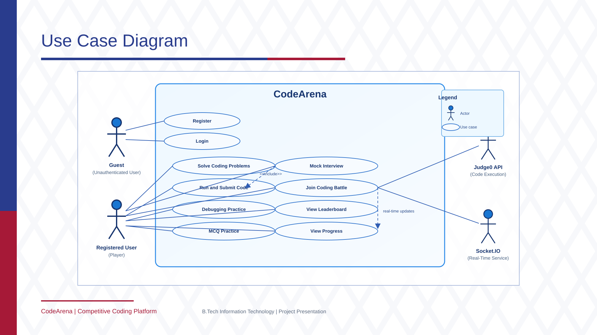

# CodeArena Use-Case Diagram

## Scope

This diagram contains only the actors and interactions implemented in the current CodeArena project:

- **Guest:** registers or logs in.
- **Registered User:** solves coding problems, runs and submits code, practices debugging and MCQs, starts mock interviews, joins coding battles, and views progress and rankings.
- **Judge0 API:** executes submitted code and returns the result.
- **Socket.IO:** supports real-time matchmaking and battle updates.

## Why Admin Is Not Included

The current version does not provide a user-facing admin workflow. The initial problem, debugging, and MCQ data is project data supplied during development. Therefore, Admin is not an actor in the running system and should not appear in this use-case diagram.
